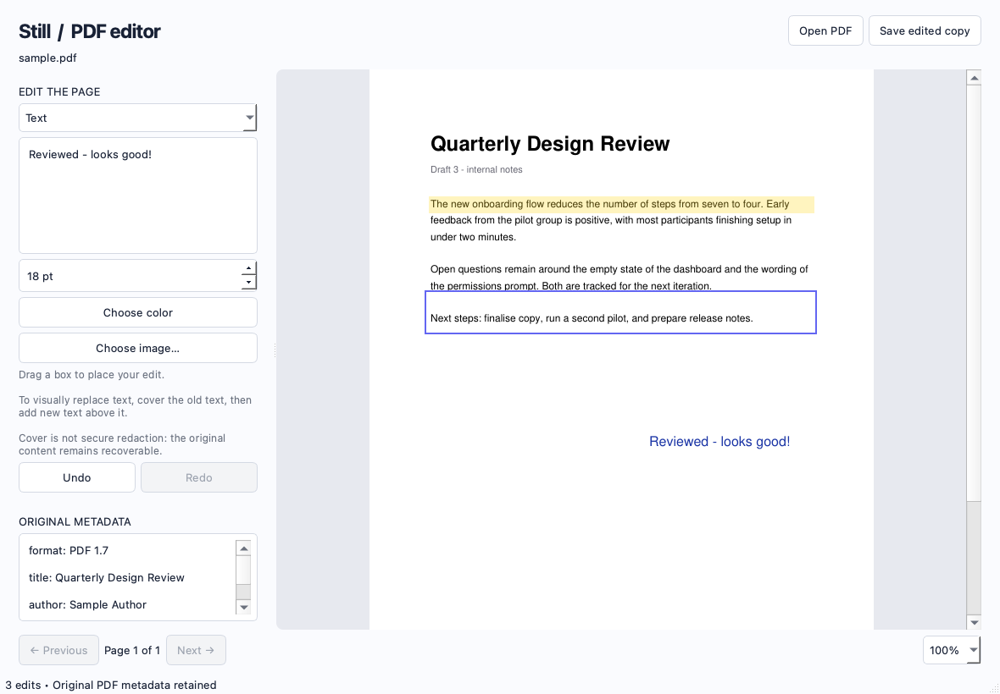
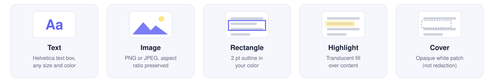
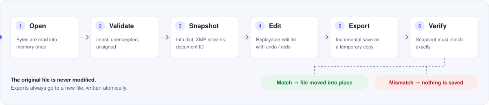

<div align="center">

<picture>
  <source media="(prefers-color-scheme: dark)" srcset="assets/hero-dark.svg">
  <source media="(prefers-color-scheme: light)" srcset="assets/hero-light.svg">
  
</picture>

<br>


[Quick start](#-quick-start) · [Tools](#-the-five-tools) · [How it works](#-how-it-works) · [Limitations](#-limitations) · [FAQ](#-faq)

</div>

---

**Still** is a small desktop app for marking up PDFs. Open a file, drag a box on the page, and drop in text, an image, a shape, a highlight or a cover patch. When you are done, it saves an edited **copy** — the file you opened is never touched.

There is no account, no upload and no server. The whole app is two Python files.

<div align="center">
  
</div>

## ✨ Why Still

| | |
|---|---|
| 🔒 **Local only** | Files are read from disk and written back to disk. Nothing leaves your computer. |
| 🛟 **Original stays intact** | You can only save to a *new* file. Saving over the source is refused. |
| ↩️ **Undo and redo everything** | Edits are a replayable list, not changes baked into the page. |
| 🧾 **Metadata is checked on export** | The document's Info dictionary, XMP streams and ID are compared before and after. If they differ, nothing is written. |
| 🪶 **Tiny** | Around 400 lines of Python and two dependencies. |

## 🚀 Quick start

You need **Python 3.10 or newer** (developed on 3.14).

```bash
git clone https://github.com/thisisshivamtiwari/pdfeditor.git
cd pdfeditor

python3 -m venv .venv
source .venv/bin/activate        # Windows: .venv\Scripts\activate
pip install -r requirements.txt

python app.py                    # or: python app.py path/to/file.pdf
```

<details>
<summary><b>First edit in 30 seconds</b></summary>

<br>

1. Click **Open PDF** and choose a file.
2. Pick a tool from the dropdown under **EDIT THE PAGE**.
3. For **Text**, type into the box in the sidebar and set the size. For **Image**, click **Choose image…**.
4. **Drag a box** on the page where the edit should go.
5. Click **Save edited copy**. The default name is `<original>-edited.pdf`.

</details>

<details>
<summary><b>Keyboard shortcuts</b></summary>

<br>

| Action | macOS | Windows / Linux |
|---|---|---|
| Open PDF | <kbd>⌘</kbd> <kbd>O</kbd> | <kbd>Ctrl</kbd> <kbd>O</kbd> |
| Save edited copy | <kbd>⌘</kbd> <kbd>S</kbd> | <kbd>Ctrl</kbd> <kbd>S</kbd> |
| Undo | <kbd>⌘</kbd> <kbd>Z</kbd> | <kbd>Ctrl</kbd> <kbd>Z</kbd> |
| Redo | <kbd>⇧</kbd> <kbd>⌘</kbd> <kbd>Z</kbd> | <kbd>Ctrl</kbd> <kbd>Y</kbd> |

Page navigation and zoom (75% – 200%) are in the bar at the bottom of the window.

</details>

## 🧰 The five tools

<picture>
  <source media="(prefers-color-scheme: dark)" srcset="assets/tools-dark.svg">
  <source media="(prefers-color-scheme: light)" srcset="assets/tools-light.svg">
  
</picture>

| Tool | What it does | Uses the chosen color |
|---|---|:---:|
| **Text** | Fits your text into the box you drag, in Helvetica, from 6 pt to 144 pt. | ✅ |
| **Image** | Places a PNG or JPEG inside the box, keeping its proportions. | — |
| **Rectangle** | Draws a 2 pt outline. | ✅ |
| **Highlight** | Draws a translucent fill (28% opacity) over the content. | ✅ |
| **Cover** | Draws an opaque white patch over the content. | — |

> [!WARNING]
> **Cover is not redaction.** It paints over content; it does not remove it. The text underneath can still be selected, searched and extracted. Do not use it to hide sensitive information.

## 🔍 How it works

<picture>
  <source media="(prefers-color-scheme: dark)" srcset="assets/pipeline-dark.svg">
  <source media="(prefers-color-scheme: light)" srcset="assets/pipeline-light.svg">
  
</picture>

<details open>
<summary><b>1 – 3 · Opening a file</b></summary>

<br>

The PDF is read into memory once. Still then refuses files it cannot edit safely:

- **password-protected** PDFs,
- **damaged** PDFs that needed repair to open,
- **digitally signed** PDFs, because a visual edit could invalidate the signature.

If the file passes, Still takes a **metadata snapshot**: the standard metadata fields, the Info dictionary with every object it references, every XMP metadata stream, and the document ID.

</details>

<details>
<summary><b>4 · Editing</b></summary>

<br>

Each edit is a small immutable record: page, tool, rectangle, color, text, size, image bytes. Edits live in a list and are never written into the in-memory PDF.

To show a page, Still opens a fresh copy of the original bytes, replays that page's edits and renders it. Undo pops the last record onto a redo stack; redo pushes it back. Every edit is test-applied before it is accepted, so text that does not fit its box is rejected immediately rather than at save time.

Rotated pages are handled: the rectangle you drag is mapped back through the page's rotation, so edits land where you drew them.

</details>

<details>
<summary><b>5 – 6 · Exporting</b></summary>

<br>

1. The original bytes are written to a temporary file next to the destination.
2. All edits are applied and saved as an **incremental update** — new objects are appended to the end of the file, and the original bytes stay in place underneath.
3. The temporary file is reopened and a second metadata snapshot is compared with the first.
4. If they match, the temporary file is moved onto the destination in one atomic step. If they do not, the export fails and the temporary file is deleted.

Because the save is incremental, the edited copy still contains the original revision of the document. Anyone with a PDF tool can see that the file was updated and recover the earlier version.

</details>

## 🗂 Project layout

```text
pdfeditor/
├── app.py             # The window: canvas, sidebar, toolbar, shortcuts (PySide6)
├── pdf_engine.py      # Document, Edit, metadata snapshot, export (PyMuPDF)
├── requirements.txt   # PyMuPDF and PySide6, pinned
└── assets/            # Images used by this README
```

`pdf_engine.py` has no dependency on the user interface, so it can be used on its own:

```python
from pdf_engine import Document, Edit

doc = Document("report.pdf")
doc.add(Edit(page=0, tool="Highlight", rect=(70, 150, 525, 170), color=(1.0, 0.85, 0.1)))
doc.add(Edit(page=0, tool="Text", rect=(330, 430, 530, 470), text="Reviewed", size=16))
doc.export("report-edited.pdf")
```

Rectangles are `(x0, y0, x1, y1)` in PDF points, measured from the top-left of the page as displayed. Colors are RGB values from 0 to 1.

## 🚧 Limitations

- **No editing of existing text.** Still adds content on top of a page; it does not rewrite what is already there.
- **Western European characters only** in the Text tool. It uses the built-in Helvetica font, which cannot represent other scripts.
- **One font**, no bold or italic.
- **Edits cannot be moved or resized** once placed. Undo and draw again.
- **No page operations**: no reorder, rotate, delete, merge or split.
- **Encrypted, signed and damaged PDFs** are refused.
- **Light theme only** in the app itself.
- **No automated tests yet.**

## ❓ FAQ

<details>
<summary><b>Does my PDF get uploaded anywhere?</b></summary>

<br>

No. The app makes no network requests. It reads the file you open and writes the file you save.

</details>

<details>
<summary><b>Can I overwrite the original file?</b></summary>

<br>

No, by design. Choosing the source file as the destination shows an error and asks for a different name.

</details>

<details>
<summary><b>Why did my text get rejected with "Text does not fit"?</b></summary>

<br>

The box you dragged is too small for the text at the current size. Drag a larger box or lower the point size.

</details>

<details>
<summary><b>Can I use Cover to redact something?</b></summary>

<br>

No. Cover only hides content visually, and because exports are incremental the earlier revision also remains in the file. Use a dedicated redaction tool that removes the underlying content.

</details>

<details>
<summary><b>What does "Metadata verification failed" mean?</b></summary>

<br>

The saved result did not carry the same Info dictionary, XMP streams or document ID as the file you opened. Still treats that as an error and writes nothing, so you never end up with a half-correct file.

</details>

## 🙏 Built with

- [PyMuPDF](https://pymupdf.readthedocs.io/) — PDF rendering and writing
- [PySide6](https://doc.qt.io/qtforpython-6/) — the Qt user interface

<div align="center">
<br>
<sub>Made by <a href="https://github.com/thisisshivamtiwari">Shivam Tiwari</a></sub>
</div>
